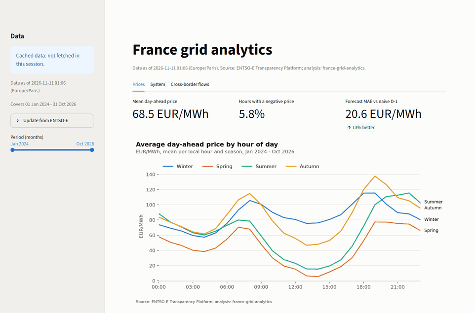
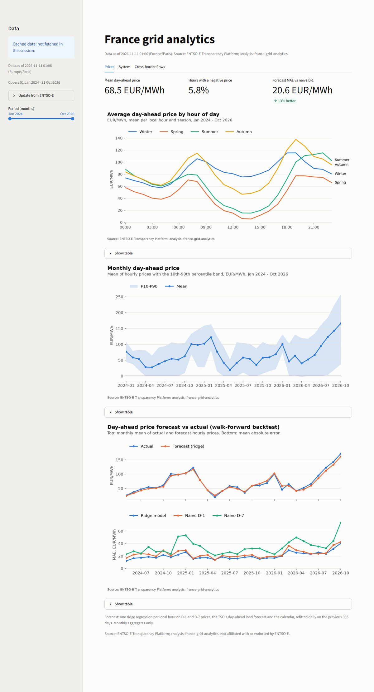
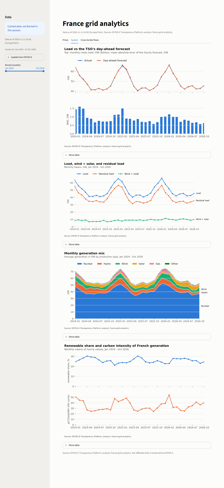
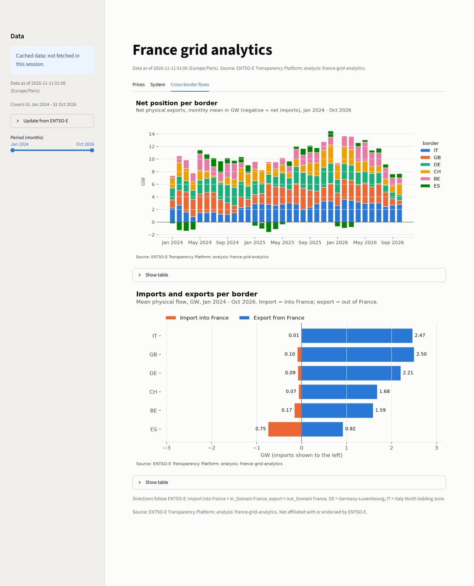

# france-grid-analytics

Analytics on the French power system built directly on the
[ENTSO-E Transparency Platform](https://transparency.entsoe.eu) API, with a local Streamlit
dashboard: day-ahead prices at their native 15-minute resolution, load and the TSO's load
forecast, generation by type, and cross-border physical flows. On top of that sit a small set of
transparent indicators and a day-ahead price forecast that is backtested honestly against naive
baselines.



## Quick start

```bash
python -m venv .venv
. .venv/bin/activate            # Windows: .venv\Scripts\activate
pip install -e ".[app]"         # add ",dev" for the test and lint tools
cp .env.example .env            # put your own ENTSO-E token in .env
git config core.hooksPath .githooks

frgrid fetch --start 2024-01-01 --end 2026-11-01   # download into the git-ignored data/ folder
frgrid dashboard                                    # open http://localhost:8501
```

Get a token by registering on the Transparency Platform and asking for "Restful API access"
(see the platform's help article "How to get security token?"). Dates are Europe/Paris days and
`--end` is exclusive. Downloads are cached per calendar quarter, and `fetch` stops cleanly after
9 minutes (`--max-minutes`), so rerunning the same command resumes where it stopped. 34 months
take 192 requests.

`frgrid report` rebuilds the charts and tables of this README from the local data.

## The dashboard

`frgrid dashboard` (or `streamlit run app/streamlit_app.py`) serves the app on `localhost` only.

| Tab | Content |
|---|---|
| Prices | average price by hour of day and season, monthly mean with P10-P90 band, forecast vs actual from the backtest |
| System | load vs the TSO's day-ahead forecast, residual load, generation mix, renewable share and CO2 intensity |
| Cross-border flows | monthly net position per border, mean imports and exports per border |

* **Freshness**: the header and sidebar show *Data as of* the time the stored data were fetched.
  The sidebar says *LIVE* only after a successful fetch from ENTSO-E in the current session;
  otherwise it says *Cached data*.
* **Update from ENTSO-E** (sidebar) fetches a date range through the same client and cache as the
  CLI: settled windows come from disk, only recent ones are downloaded (at most 3 minutes).
* A month-range slider filters every chart; each chart has a *Show table* view.
* Empty, partial and error states are explicit (no data yet, a dataset missing, no token,
  ENTSO-E error, time budget reached). The UI never shows file paths.
* Every figure is a monthly or hourly-profile *aggregate* and carries the source line; no raw
  time series are displayed.

The data layer (`frgrid.dashboard.data`) has no Streamlit dependency and is unit-tested offline;
the app itself is tested headless with Streamlit's `AppTest`.

| Prices | System | Cross-border flows |
|---|---|---|
|  |  |  |

## What is in here

| Module | Purpose |
|---|---|
| `frgrid.client` | HTTP client: token in a header only, retries with back-off, rate limiting, local cache |
| `frgrid.parse` | XML parser: A01/A03 curves (A03 omits repeated values), mixed PT15M/PT60M periods |
| `frgrid.datasets` | France datasets on a uniform 15-minute UTC grid |
| `frgrid.analytics` | daily profiles, residual load, renewable share, CO2 intensity, net imports |
| `frgrid.forecast` | walk-forward backtest of a day-ahead price model vs naive baselines |
| `frgrid.dashboard` | UI-free data layer and figure builders for the dashboard |
| `frgrid.charts`, `frgrid.style` | README charts and the shared chart style |
| `app/streamlit_app.py` | the Streamlit UI |

## Security model for the API token

* The token is read from `ENTSOE_API_TOKEN` or a git-ignored `.env`, and kept in a wrapper whose
  `repr`/`str` never show it.
* It is sent **only in the `SECURITY_TOKEN` HTTP header**, never in the URL, and only to
  `https://web-api.tp.entsoe.eu`; system proxy settings are ignored and redirects are not
  followed. Error messages, logs and cache keys are built without it (and tests check that).
* `scripts/check_secrets.py` blocks token-shaped strings (UUIDs), literal `securityToken=` values,
  the local token itself and `.env` files. It runs as a git pre-commit hook, and in CI on the
  tracked files and on the full history (`--history`).
* CI uses no secrets. Tests run offline on scrubbed sample responses and synthetic data; the test
  suite hides the developer's `.env` and makes any real HTTP request fail.
* The dashboard binds to `localhost`, sends no usage statistics and shows no error tracebacks.

## Definitions

* **Time**: ENTSO-E timestamps are UTC interval starts; profiles are in Europe/Paris local time.
  Hourly values are means of the four quarter-hours (an hour with a missing quarter is missing).
* **Day-ahead price**: hourly until 30 September 2025, quarter-hourly from 1 October 2025
  (SDAC 15-minute market time unit). Hourly prices are repeated onto the 15-minute grid; the
  native resolution is kept in a `resolution_min` column.
* **Generation**: sum of production types, excluding storage output (pumped-storage turbining,
  "Energy storage") and all consumption series (pumping, storage charging). A timestamp where a
  core type (nuclear, gas, run-of-river, reservoir, solar, onshore wind) is missing is missing;
  minor types not reported (e.g. hard coal after its last plant stopped) count as zero.
* **Renewable share**: biomass, geothermal, run-of-river and reservoir hydro, marine, other
  renewable, solar and wind over generation. Waste is excluded (only partly biogenic).
* **Residual load**: actual load minus solar, onshore and offshore wind.
* **CO2 intensity**: production-based, life-cycle gCO2eq/kWh of domestic generation, imports
  excluded. Factors are IPCC AR5 WGIII Annex III (Table A.III.2) medians where they exist; oil,
  waste and "other" are flagged assumptions (together about 1% of output). Life-cycle values are
  higher than the direct-emission figures published by RTE, by construction.
* **Flows**: physical flows (A11). Import into France = `in_Domain` France; export = `out_Domain`
  France. Germany and Italy are the DE-LU and IT-North bidding zones.

## Results (January 2024 - October 2026)


Nuclear supplies 34-53 GW as a monthly average; total generation peaks in winter at up to 75 GW.


The merit order shows up directly: hourly prices rise with the load left after wind and solar
(correlation 0.53), with negative prices concentrated at low residual load. The chart shows binned
counts of hours, not the price series.


France exported on every border on average; Spain is the border where it turns net importer
in winter and spring months.

### Day-ahead price forecast, backtested

Target: the hourly French day-ahead price of day D. Inputs are restricted to what is public
before the auction on D-1: prices of D-1 and D-7, the mean price of D-1, the TSO's day-ahead load
forecast for D, and Monday/Saturday/Sunday dummies. One ridge regression per local hour, refitted
every day on the previous 365 days (walk-forward, no look-ahead; a test checks this). The design
and penalty were fixed before running the backtest; nothing was tuned on it.


Backtest: 891 delivery days, 10 May 2024 - 31 Oct 2026, 21,384 hourly forecasts.

| | Ridge model | Naive D-1 | Naive D-7 |
|---|---:|---:|---:|
| MAE (EUR/MWh) | 20.6 | 23.7 | 34.3 |
| RMSE (EUR/MWh) | 28.2 | 35.0 | 47.7 |
| bias (EUR/MWh) | -2.0 | -0.1 | -1.5 |
| MAE 2024 | 18.3 | 23.1 | 30.3 |
| MAE 2025 | 17.6 | 20.0 | 31.1 |
| MAE 2026 | 26.0 | 28.5 | 41.3 |

MAE reduction vs naive D-1: 13%; vs naive D-7: 40%. Diebold-Mariano test on daily mean absolute
errors (Newey-West, 7 lags): -8.7 vs D-1 and -12.5 vs D-7, p < 0.001 for both.

## Limitations

* **The forecast is modest**: a statistically clear improvement over "same hour yesterday", not
  a trading signal. It does not win every month (May 2025 is a tie; in July 2026 it is 2.1
  EUR/MWh worse than naive D-1), its error rises with the higher 2026 price levels, and it has a
  small negative bias. It uses no weather, fuel or carbon prices, nor wind and solar forecasts.
* **Data are used as published.** ENTSO-E does not check them; recent days can be revised, which
  is why only windows older than seven days are cached.
* **CO2 intensity** is a life-cycle, production-based estimate with a few assumed factors; it is
  not comparable one-to-one with RTE's direct-emission figures and ignores imports.
* **Flows** are physical, not commercial schedules; FR-GB data provided by the IFA interconnector
  are outside ENTSO-E's CC BY list (see DATA.md).
* **France only**, one bidding zone, from January 2024. The dashboard is a local tool, not a
  hosted service, and only shows aggregates.

### Data quirks seen

* ENTSO-E reports a few odd consumption series for France (e.g. "Wind Onshore (consumption)",
  April 2025 - January 2026). Consumption series never enter generation here.
* Nuclear is missing for 122 quarter-hours; those timestamps are treated as missing.
* ENTSO-E answers "no matching data" and real errors (e.g. "interval too long") with the same
  reason code 999; the client tells them apart by the reason text.

## Data and licence

Code: MIT (see `LICENSE`). Data: not included. See [DATA.md](DATA.md) for the ENTSO-E terms,
which datasets are under CC BY 4.0 and which are not (day-ahead prices, actual load and actual
generation are not on ENTSO-E's free re-use list), and attribution.

Source of all data shown: ENTSO-E Transparency Platform. This project is not affiliated with or
endorsed by ENTSO-E.

## Development

```bash
pip install -e ".[dev,app,screenshots]"   # screenshots: Playwright, needed by mypy
python scripts/check_secrets.py --all       # and --history for every past commit
ruff check . && ruff format --check .
mypy                                        # strict
pytest                                      # offline
python scripts/capture_dashboard.py         # README screenshots + GIF (".[screenshots]" extra)
```
